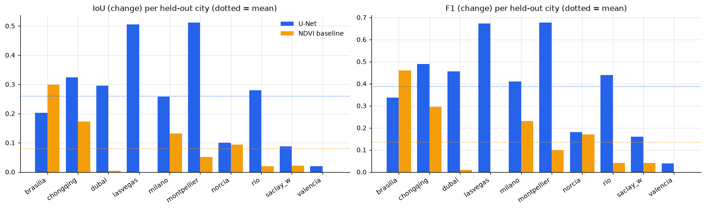
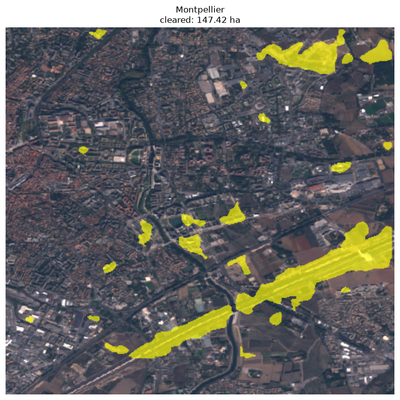
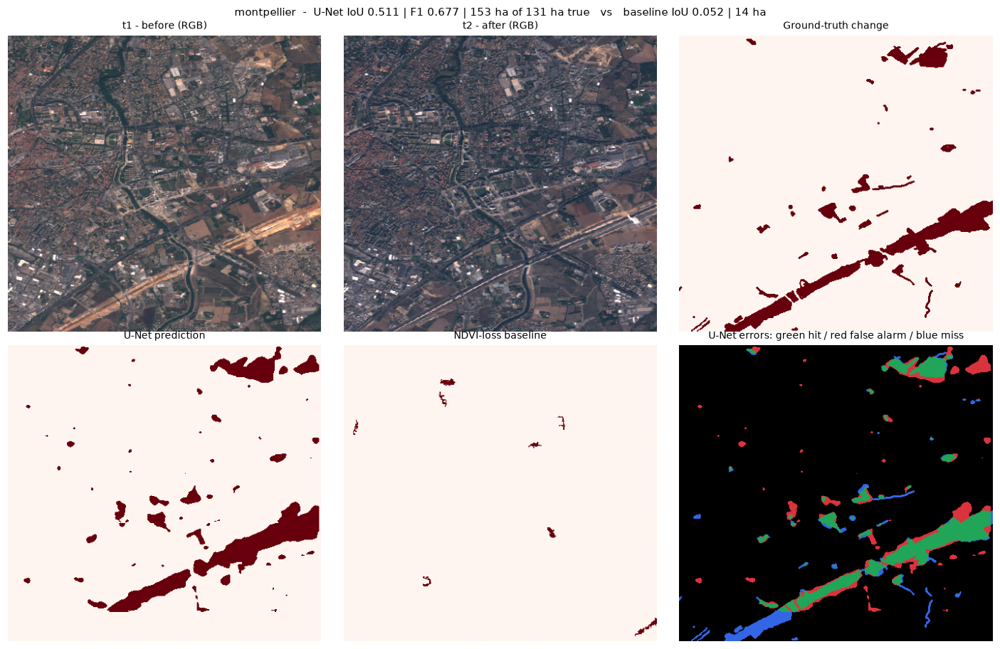
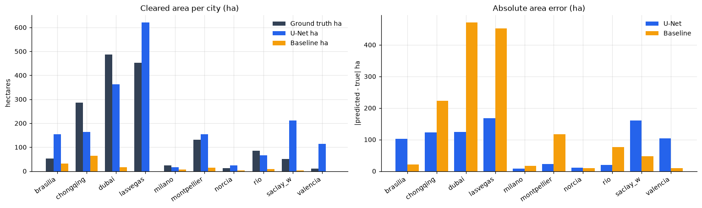
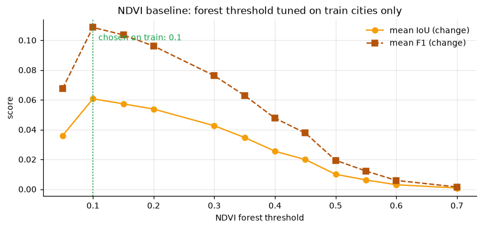
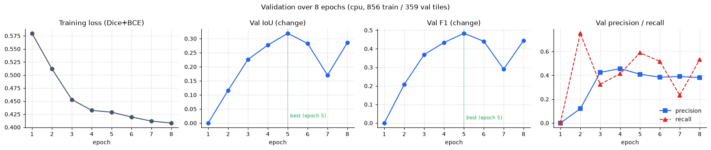

# Forest Change Detection (Sentinel-2 / OSCD)

End-to-end pipeline for detecting **deforestation and land-cover change** from
multi-date Sentinel-2 imagery, built on the [OSCD (Onera Satellite Change
Detection)](https://rcapek.github.io/oscd-dataset/) benchmark. It downloads and
extracts the dataset, normalises and tiles it, trains a U-Net change
segmentation model, computes an NDVI-loss baseline for comparison, and evaluates
**per-city** on the official held-out test split with pixel metrics and
hectare-scale area accounting.



## About

**The problem.** Forest loss is reported as annual national totals, but the
decisions that cause and prevent it happen at the scale of individual patches:
a clearing, a licensed plantation, a fire scar. Reading that from satellite
imagery is easy to demo and hard to do honestly — changed pixels are 1-5% of a
scene, and cloud, shadow and seasonal greenness all imitate deforestation.

**The data.** [OSCD (Onera Satellite Change
Detection)](https://rcapek.github.io/oscd-dataset/) — 24 cities, each with a
pair of co-registered Sentinel-2 L2A images from different years, 12 usable
bands per date, plus hand-drawn binary deforestation masks. The official split
is 14 train cities / 10 test **cities**, not tiles. The ~38 GB archive is
fetched from Hugging Face at runtime; nothing binary is bundled here.

**Two models on identical input:**

- a **U-Net** (MobileNetV2 encoder via `segmentation-models-pytorch`) over
  128×128 tiles of 24 channels (12 bands × 2 dates), with an NDVI layer,
  cloud/shadow masking, per-band normalisation and a Dice+BCE loss, because
  plain BCE collapses to "no change everywhere" when change is 1-5% of a tile;
- an **NDVI-loss baseline** — a per-pixel greenness-loss threshold — as the
  reference a domain expert would build by hand, so the learned model has to
  beat something other than itself.

**Why the numbers here can be trusted:**

- **City-level split.** Tiles never cross a city boundary, and no tile of a
  held-out city is ever seen in training. Tiling first and splitting tiles at
  random leaks adjacent-tile structure and inflates every score.
- **The baseline's threshold is tuned on the 14 train cities only**, then
  frozen before the test evaluation, so the comparison is uncontaminated.
- **Checkpoint selection on validation IoU, never on test score.**
- **Area accounting beside the pixel metrics.** IoU says how well the *shape*
  matches; hectares say whether the *amount* of cleared land is right. On
  `valencia` the model scores 0.23 IoU yet predicts 114 ha against 9.7 ha true
  — the two views disagree, and both are reported.
- **Full-city inference for evaluation**, not the 128×128 tiles the model
  trained on, so tile-border artefacts do not leak into the metrics.

**What it is not:** not a production monitoring system. There is no temporal
series, no seasonal modelling and no SCL/QA60 cloud-mask layer (OSCD does not
ship one), and a full 8-epoch run is ~108 min on a 4-thread CPU.

## Results

Mean over the 10 held-out test cities (full-city inference, best checkpoint by
validation IoU):

| Model | IoU (change) | F1 (change) | Precision | Recall |
| --- | --- | --- | --- | --- |
| U-Net (mobilenet_v2, 24 ch, 8 epochs) | **0.2586** | **0.3862** | 0.3928 | 0.4642 |
| NDVI-loss baseline | 0.0793 | 0.1345 | - | - |

The full table with per-city breakdown and area accounting lives in
[results/results_table.md](results/results_table.md).

### What the numbers say

- The U-Net wins on **mean** IoU (0.26 vs 0.08) and F1 (0.39 vs 0.13), and is
  best on the cities with subtle or fragmented change: `montpellier` 0.51,
  `lasvegas` 0.51, `chongqing` 0.32.
- The baseline wins only where the change is a **pure, large-scale greenness
  drop**: on `brasilia` it reaches 0.30 IoU, largely because it puts almost all
  of its predictions where the U-Net over-predicts area.
- `montpellier` — sparse ground truth and clean imagery — produces sensible,
  well-localised maps:



### Live results console

The same numbers, plus the per-city area accounting, the per-epoch validation
history and the raw JSON artefacts, are published as a static site — open it in
a browser with nothing installed:

**https://bakkarranna.github.io/deforestation-detection/**

It is generated from the committed JSON artefacts, not retrained, so the page
can never disagree with the tables above:

```bash
python -m forest_change.dashboard --strict    # writes docs/index.html
```

`docs/index.html` is committed and served by
[.github/workflows/pages.yml](.github/workflows/pages.yml).



- Pixel scores and hectare accounting disagree honestly. The model
  over-predicts hectares on `valencia` (114 ha vs 9.7 ha true) and `saclay_w`
  (211 ha vs 50 ha), under-predicts on `norcia` (23.9 ha vs 24.2 ha with only
  0.0998 IoU — it finds the right area in the wrong places), and on bare
  `lasvegas`/`dubai` it drifts toward labelling all non-forest land as change.



- The NDVI threshold used by the baseline was tuned on the 14 labelled train
  cities and then frozen for the held-out test evaluation, so the test numbers
  above are uncontaminated:



- Validation converges to 0.2857 IoU (change) by epoch 08, with the best
  checkpoint at epoch 05 (0.3187) — the three extra epochs overfit slightly:



Analysis of the failure modes is in [notes.md](notes.md).

## Pipeline

```
forest_change/
  config.py         paths, dataset constants, hyperparameters
  download.py       resumable parallel download + extraction of the OSCD archives
  data.py           City loading, mask decoding, tiling, train/val/test split
  preprocess.py     NDVI, cloud/shadow masking, band normalisation
  models.py         U-Net (smp) with a recorded encoder + DiceBCELoss
  train.py          training loop, checkpointing, per-city evaluation
  evaluate.py       pixel metrics (IoU, F1, precision, recall) and area accounting
  baseline.py       NDVI-loss baseline used as a reference model
  change.py         full-city change maps and the connected-component speckle filter
  visualize.py      true-colour composites and cleared-forest overlay maps
  figures.py        all result figures
  results_table.py  markdown + CSV + JSON results table generation
```

Two decisions drive the result:

- **City-level split** — tiles never cross cities, so neighbouring tiles of a
  test city can't leak into training.
- **Dice + BCE loss** — changed pixels are 1-5% of every tile, so plain BCE
  collapses to "no change everywhere". Dice (0.5 weight) keeps the gradient
  alive on the minority class.

## Repository layout

```
src/forest_change/   pipeline source and the console renderer
tests/               pure numpy/scipy unit tests (no torch, no data needed)
docs/                the static results console published to GitHub Pages
results/             metrics, tables, logs and the figures above
data/                dataset, downloaded on demand (git-ignored)
.github/workflows/   CI: install, ruff lint, pytest; Pages: publish docs/
```

## Getting started

Requires **Python 3.10+**.

```bash
python -m venv .venv
.venv/Scripts/activate          # Windows; source .venv/bin/activate on Linux/macOS
pip install -e ".[dev]"         # numpy, scipy, rasterio, torch, smp, sklearn, matplotlib, pandas
```

### Download the data

The ~38 GB OSCD archive is fetched from Hugging Face in 16 parallel 8 MB chunks
into `data/raw/`, and resumes from `.part` files if interrupted:

```bash
python -m forest_change.download data/raw
```

Each interrupted chunk is refetched with retries, and the downloader reports any
archive it could not complete rather than letting you train on truncated data.

## Training and evaluation

Train and evaluate in one command — it writes `results/metrics.json`, the
per-city probability maps, and appends a row per run to `results/runs.csv`:

```bash
python -m forest_change.train                        # data/raw -> results/
python -m forest_change.train data/raw results       # explicit input/output dirs
python -m forest_change.baseline                     # NDVI-loss baseline + threshold tuning
```

Hyperparameters (epochs, batch size, learning rate) live in
[src/forest_change/config.py](src/forest_change/config.py); `train()` also takes
`epochs` / `batch_size` / `lr` / `quick` arguments for notebook use.

Artifacts per run: `results/model.pt` (best val-IoU checkpoint, with the encoder
name and channel count recorded so it reloads exactly), `results/band_stats.npy`
(normalisation constants), and one `results/prob_<city>.npy` prediction map per
test city.

A full 8-epoch run takes ~108 min on a 4-thread CPU with batch 8 and 128×128
tiles; the measured per-step cost of MobileNetV2 vs ResNet-34 is documented in
[src/forest_change/config.py](src/forest_change/config.py).

## Reproducing the tables and figures

```bash
python -m forest_change.results_table            # results_table.md, .csv and .json
python -m forest_change.figures data/raw results  # needs data/raw and the prob_*.npy maps
```

The tables are regenerated from `results/metrics.json` plus
`results/baseline_metrics.json` alone. The qualitative figures need the raw data
and the `prob_*.npy` probability maps that `train` writes — the per-city charts
are read from those maps rather than re-running the model, so they show exactly
the prediction the metrics were computed from.

## Tests

```bash
pytest                # 21 unit tests, pure numpy/scipy
ruff check src tests
```

The 12 dashboard tests cover the renderers directly: the mean is an unweighted
mean over cities, the no-change-only probe is derived rather than asserted, the
per-city table sorts best-to-worst and carries the area accounting, every
committed figure is copied beside the page with its caption, a re-run is
idempotent, and the built document is one self-contained page with no remote
assets and no dead in-page links.

CI runs the tests, lint and both smoke jobs on every push and pull request
([.github/workflows/ci.yml](.github/workflows/ci.yml)), and
[.github/workflows/pages.yml](.github/workflows/pages.yml) publishes the console
to GitHub Pages on `main`.

## Implementation notes

- **Dataset quirk**: the shipped OSCD change masks are encoded `1/2`, never
  `0/1`, so a naive `> 0` read marks every pixel as changed.
  [data.decode_mask](src/forest_change/data.py) detects the encoding by value
  range and still decodes a repackaged `0/1` copy correctly.
- **No cloud mask**: OSCD ships only the 12 L2 spectral bands, with no SCL or
  QA60 scene-classification band, so no explicit cloud layer can be built. Thin
  cloud edges are instead handled by the speckle filter below; residual cloud
  artefacts are one of the known failure modes noted in [notes.md](notes.md).
- **Speckle filter**: connected components below 50 px (0.05 ha at 10 m) are
  dropped — co-registration noise and thin cloud edges are not clearings.
- **Baseline tuning**: the NDVI forest threshold is tuned on train cities only
  and frozen for the test evaluation.
